# WeatherPro

WeatherPro 是一款为 [TrafficMonitor](https://github.com/zhongyang219/TrafficMonitor) 开发的天气信息插件，支持多种数据源和丰富的自定义选项。

本项目原始仓库为 [Haojia521/TrafficMonitorPlugins](https://github.com/Haojia521/TrafficMonitorPlugins)，曾发布至 v0.14 版本，现已被归档。当前仓库对代码进行了全面重构与升级，并正式发布 v1.0 版本，后续的新版本也将在此仓库中发布。

建议与TrafficMonitor v1.86及以上版本配合使用。

> 注意： 本项目主要面向 Windows x64 开发与调试；x86 版本仅编译、未测试，可能存在问题。

## 功能特性

- 支持多种天气接口 （配置方法请参考[接口说明](docs/DataSourceGuide.md)）
  - 天气网 (weather.com.cn)
  - 和风天气 (qweather.com)
  - OpenWeather (openweathermap.org) *(现已支持Onecall 4.0)*
- 支持在横置任务栏占用两行显示天气信息
- 支持设置数据常驻显示区
- 支持在固定宽度的主窗口区滚动显示长文本
- 支持丰富的天气信息自定义控制选项

## 版本更新

- v1.4.0

  - [新增] 设置界面添加仅执行一次自动定位的选项
  - [优化] 适配和风天气最新 **实时天气** 接口，新增了紫外线指数、降水数据
  - [优化] 适配和风天气最新 **每日天气预报** 接口, 可区分日间/夜间详细预报，新增风力、降水数据
  - [优化] 增加插件ICON图标，改进部分日志信息
  - [修复] 适配和风天气最新JWT身份验证规则，需填写 **开发者ID**，具体请参考[配置说明](docs/DataSourceGuide.md#232-jwt)
 
[查看历史更新](#历史更新)

## 程序界面介绍

- 任务栏窗口主数据显示区

  显示天气+气温，天气可渲染为图标或文本。新版支持按固定宽度显示，并滚动显示长文本。此处的天气数据可选择当前天气、今日天气、24\~48小时天气、48\~72小时天气。

  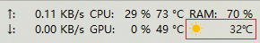

  v1.1新增双行显示模式。当前任务栏为水平状态、TrafficMonitor的显示项目个数为奇数并且WeatherPro主项目位于最后，则可以占用两行空间绘制图标和文本。

  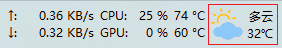

  v1.0版本支持设置常驻信息显示区，按选定的时间段与数据项目显示数据。修改常驻显示区配置后需要重启TrafficMonitor使配置生效。

  > 修改常驻项的标签文本方法：打开TrafficMonitor「选项设置」窗口，进入「任务栏窗口设置」页，在「显示设置」区域，点击「显示文本设置」按钮，打开「显示文本设置」窗口即可修改

  > 注意：接口可能缺失特定数据，显示「--」

  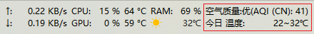

- 鼠标提示弹窗

  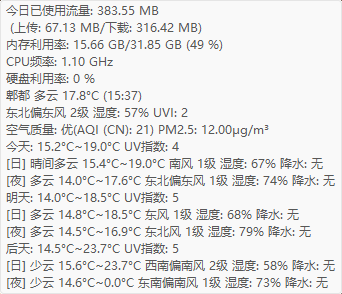

  > 上图为使用和风天气接口的数据内容。具体显示项目可在API选项窗口配置。

- 设置界面

  配置数据源、位置和数据显示方式等内容。当有新版本发布时，界面底部将显示“有新版”按钮引导用户下载。

  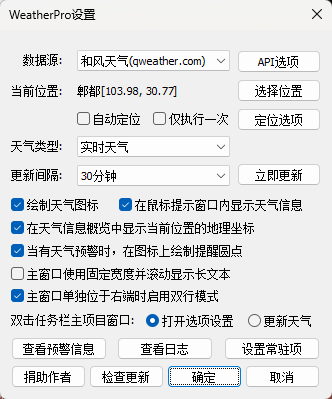

- API设置界面

  天气网API-weather.com.cn设置。

  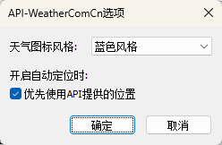

  和风天气API-qweather.com设置。

  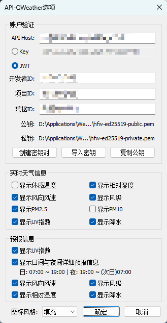

  OpenWeather API-openweathermap.org设置

  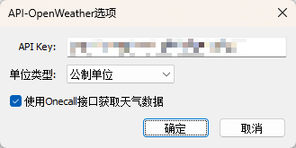

- 位置设置界面

  除按文本查询位置外，新增支持按经纬度查询位置。经纬度信息在特定接口是必需的，如和风天气(qwather.com)空气质量查询接口和OpenWeather的接口。

  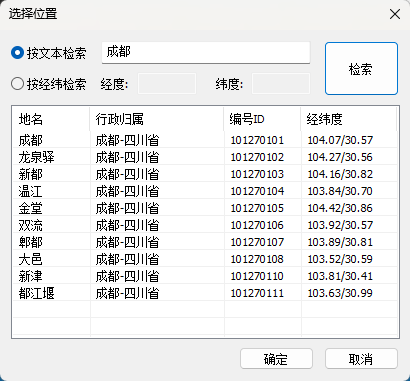

- 常驻显示区设置

  按照时间段+数据项设置常驻区。常驻区的显示顺序以及标签文本，可在TrafficMonitor的任务栏窗口设置页修改。

  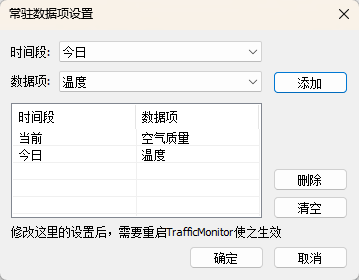

- 定位设置

  自由选择自动定位的方式。如果所有方式均失败将不改变当前的位置信息。

  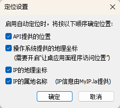

## 项目构建

请参考[构建说明文档](docs/Build.md)。

## 历史更新

- v1.3.0/1.3.1

  - [新增] 在插件右键菜单中添加了常用命令
  - [优化] 适配OpenWeather OneCall 4.0接口
  - [优化] 改进了部分日志信息
  - [修复] 修正了OpenWeather OneCall数据单位显示错误

- v1.2.0

  - [优化] 内嵌多分辨率图标以适应不同DPI屏幕
  - [优化] 位置设置界面显示待选位置的经纬度
  - [优化] 支持主动检查插件更新
  - [优化] 在检查插件更新、手动更新天气、检索位置时，显示非阻塞进度窗口
  - [修复] 缺失天气网部分天气现象编码

- v1.1.0

  - [新增] 双行显式模式。在水平任务栏上，如果主项目窗口单独在最右端可以使用双行显式信息
  - [新增] 设置是否在天气信息概览中显示详细位置坐标
  - [修复] 日志时间戳为UTC时间而非本地时间
  - [修复] 没有使用新版插件接口设置语言
  - [修复] 和风天气API数据时间戳类型不一致
  - [修复] 解析json字符串可能导致崩溃

- v1.0.4

  - [新增] 支持OpenWeather数据源
  - [新增] 按经纬度设置目标位置
  - [新增] 主窗口区滚动显示长文本
  - [新增] 设置常驻数据显示区
  - [新增] 存在天气预警时在图标右上角绘制通知圆点
  - [新增] 新版本发布提醒
  - [优化] 自动定位支持选用API位置、操作系统定位、IP地理坐标和IP属地名称
  - [优化] 在独立窗口中查看详细的预警信息和日志
  - [修复] 查询天气信息时没有正确设置线程语言
  - [修复] 和风天气(QWeather)API在更换密钥后仍返回缓存JWT
